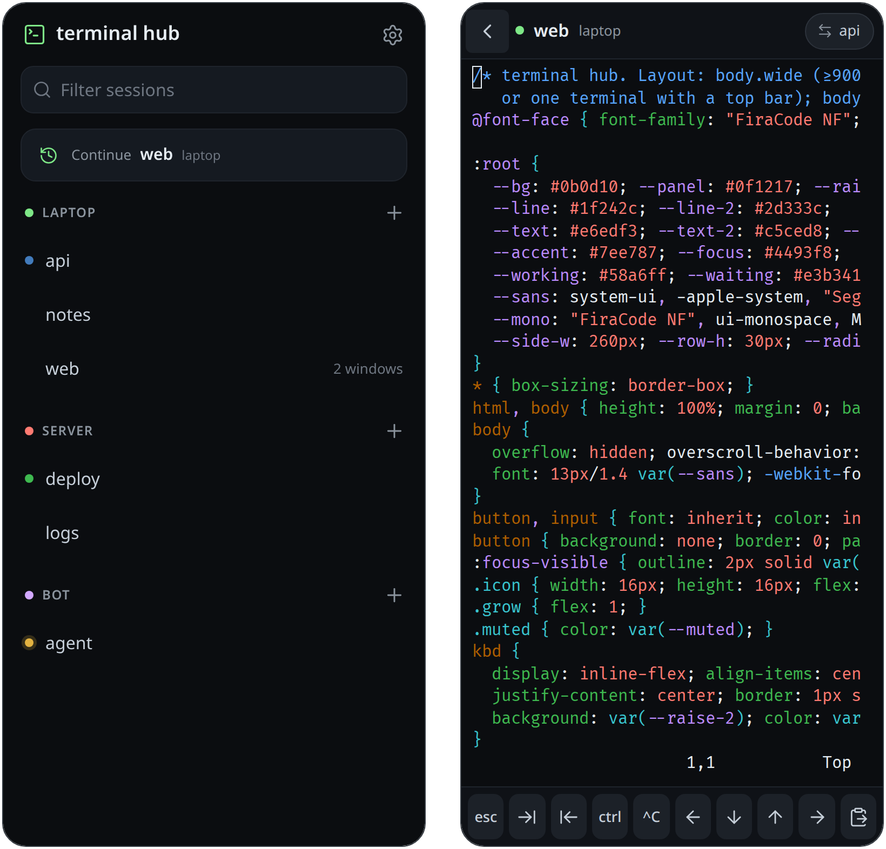
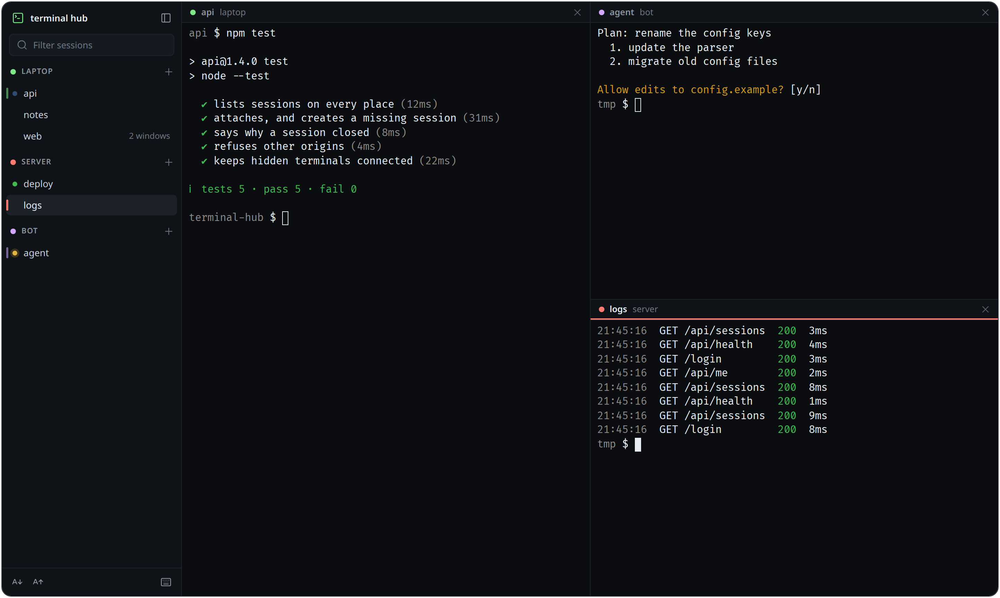

# terminal-hub

Every tmux session on your machines, in one web page that works on a phone and on a desktop.

terminal-hub lists the tmux sessions of every machine you give it (this one, others over ssh,
other users on either) and opens any of them in a real terminal: side by side on a desktop, one
at a time with a key bar on a phone. Coding agents like Claude Code get a dot that says whether
they're working, waiting for you, or done. It runs on one machine, you reach it privately over
your tailnet, and there's nothing to build: plain JavaScript, a bash script and a small Python
server around [ttyd](https://github.com/tsl0922/ttyd) and [xterm.js](https://xtermjs.org).





## What you get

- **One list across machines.** Each *place* in the config is tmux somewhere: here, on another
  machine over ssh, or as another user. A place that can't be reached says so, and one whose ssh
  key is locked offers to unlock it.
- **Desktop:** a sidebar and up to four sessions side by side. Recent sessions stay connected in
  the background, so switching is instant, and a reload brings your layout back.
- **Phone:** a home screen with every session, then one session at a time with a top bar and a
  one-row key bar for what a phone keyboard lacks (esc, tab, shift-tab, ctrl, ^C, arrows, paste).
  Swipes scroll tmux history, and the page installs as an app.
- **Agent status:** a blue dot while an agent works, yellow when it waits for you (a permission
  prompt or a question; also counted in the tab title), green when it's done, until you look.
- **New sessions** from the list: press + by a place, type a name or leave it blank.
- **`share`** moves the terminal you're in into tmux, so it shows up in the list. `share -- claude`
  starts a program in its own session.

## How it works

```
 browser (phone or desktop)
    │  HTTPS, tailnet only
    ▼
 tailscale serve ─┬─ /        →  ttyd       127.0.0.1:7682   the page, and one terminal per open session
                  └─ /assets  →  server.py  127.0.0.1:7683   the page's files, and the session list
                                     │
                              terminal-hub (bash)
                                     │
             tmux here  ·  tmux on other machines (ssh)  ·  tmux as another user (sudo)
```

Everything runs on one machine, the hub. Each session you open in the page is its own
connection to ttyd, which runs `terminal-hub KEY:NAME` to attach to that tmux session: directly,
over ssh, or through sudo. The list comes from `terminal-hub --list`, which asks every place for
its sessions at once. When a session closes, `terminal-hub` tells the page why (you detached,
the session ended, or the connection dropped), so the page can offer to reattach.

The other machines run nothing new: they need tmux, and ssh key login from the hub.

## Install

On the hub you need Linux (WSL works) with systemd user services, [ttyd](https://github.com/tsl0922/ttyd)
1.7 or newer, tmux and python3. [fzf](https://github.com/junegunn/fzf) is optional (a command-line
picker). To reach the hub you need [Tailscale](https://tailscale.com) or another proxy that
authenticates.

```sh
git clone https://github.com/Chaitanya-Keyal/terminal-hub && cd terminal-hub
./install.sh                           # the first run writes ~/.config/terminal-hub/config
$EDITOR ~/.config/terminal-hub/config  # add your places
./install.sh
loginctl enable-linger "$USER"         # keep it running while you're logged out
terminal-hub --check
```

Then publish it on your tailnet (on WSL, run these with the Windows `tailscale.exe`):

```sh
tailscale serve --bg --set-path / http://127.0.0.1:7682
tailscale serve --bg --set-path /assets http://127.0.0.1:7683
```

Open `https://MACHINE.TAILNET.ts.net` on your phone and add it to the home screen.

The hub's tmux settings are optional but recommended: they turn on mouse mode (for swipe scrolling),
size windows to whichever screen you used last, and add a quiet status line tagged with the place.
In `~/.tmux.conf` on each machine that has `~/.local/share/terminal-hub/tmux.conf`:

```tmux
set -g @hub-tag laptop               # default: the hostname
set -g @hub-colour '#7ee787'
source-file -q ~/.local/share/terminal-hub/tmux.conf
```

## Config

`~/.config/terminal-hub/config` is a bash file; [config.example](config.example) explains every
setting. Most of it is the list of places:

```bash
place laptop laptop  '#7ee787' local                           # tmux here
place srv    server  '#ff7b72' ssh myserver                    # tmux on myserver (an ssh alias)
place bot    bot     '#d2a8ff' ssh myserver sudo -u bot -H     # another user's tmux there
place box    sandbox '#79c0ff' via sudo -n -u sandbox bash -c  # another user's tmux here
```

Changes to places apply at once. The first place is "here", where links without a place open.

- ssh places need key login, because listing can't answer prompts. A key with a passphrase works
  if an ssh-agent holds it (`AddKeysToAgent yes` in `~/.ssh/config`); while it's locked, the place
  shows **Unlock**, which asks for the passphrase once.
- Session names are 1 to 32 letters, digits, `-` and `_`.

The app settings (`HUB_NAME` and friends) are built into the page, so run `./install.sh` after
changing them. `HUB_FALLBACK` makes the installed app open another URL when this machine doesn't
answer within 4 seconds, say the same hub on an always-on server.

## Using it

**Desktop.** Click a session to open it. Shift+click, or the split button that appears on hover,
opens it beside the others. The keyboard button at the bottom of the sidebar lists the shortcuts:

| | |
| --- | --- |
| Alt+↑, Alt+↓ | previous, next session |
| Alt+\` | the last session |
| Shift+click | open beside |
| Shift+drag | select text even when the app uses the mouse (selections are copied) |

**Phone.** Tap a session to open it, and use the back button (or the browser's) to return to the
list. The top bar's swap button jumps to the last session. ctrl on the key bar applies to the next
key; arrows repeat while held. The gear on the home screen sets the text size.

**Links.** `/?arg=KEY:NAME` opens session NAME on place KEY, creating it if it doesn't exist.
`/?arg=NAME` does the same on the first place, `/?arg=new` starts a new shell there, and
`/?arg=KEY:new` starts one on place KEY.

## Agent status

The dots come from two tmux options on each session, which anything inside the session can set
with `hub-state`:

```sh
hub-state working    # blue
hub-state waiting    # yellow: needs you
hub-state done       # green, until you look at the session
hub-state clear
```

**Claude Code** sets them through hooks. Add the hooks in
[integrations/claude-code.json](integrations/claude-code.json) to `~/.claude/settings.json`: if you
have no `"hooks"` there yet, copy the block in; otherwise add each event's entry to your lists.
With [jq](https://jqlang.org), this merges them for you:

```sh
jq --slurpfile h integrations/claude-code.json \
  '.hooks = ((.hooks // {}) as $old | reduce ($h[0].hooks | to_entries[]) as $e
     ($old; .[$e.key] = ((.[$e.key] // []) + $e.value | unique)))' \
  ~/.claude/settings.json > settings.tmp && cat settings.tmp > ~/.claude/settings.json && rm settings.tmp
```

Every hook runs `~/.local/bin/hub-state hook`, which reads the event and sets the dot: working
when you send a message, waiting when a permission prompt or a question opens, working again once
that tool runs, done when the turn ends (on an error too), cleared when Claude exits. A subagent
finishing its work doesn't hide a question the main agent is asking you. Outside tmux the hooks do
nothing. One gap: Claude Code has no hook for interrupting it with Esc, so after that the dot stays
blue until your next message.

Agents on other machines need `hub-state` there: copy `bin/hub-state` to `~/.local/bin/` on that
machine. OpenCode isn't supported yet: its plugins run in a shared background process, so they
can't tell which terminal an event belongs to.

## share

```sh
share [NAME] [-- COMMAND...]
```

Run in an ordinary terminal, `share` moves you into a tmux session (named after the folder, or
NAME) so it shows up in the hub; detach with your tmux prefix and `d` to get the plain terminal
back. With a command, the session runs just that command and closes when it exits. A shell
function saves typing, and passes arguments along:

```sh
cc() { share -- claude "$@"; }       # cc --resume
```

## Security

ttyd gives a shell to anyone who can reach it, so both services listen on 127.0.0.1 only. Publish
them only through something that authenticates, such as `tailscale serve` (tailnet only), and never
expose ports 7682 and 7683 directly. ttyd runs with `--check-origin`, so other websites can't open
terminals through your browser. The session list (`/assets/sessions.json`) shows session names; it's
published the same way as the rest.

## Updating and removing

```sh
./install.sh --pull                  # git pull, then install
./install.sh --uninstall             # stop and remove everything except your config
```

Updates apply when you reload the page; your tmux sessions keep running. A changed service unit
restarts ttyd, and open pages reconnect.

## Troubleshooting

`terminal-hub --check` checks the tools, the config, every place and the services.

- **A place says Unreachable:** ssh couldn't connect within 5 seconds. Try `ssh HOST true` as the
  hub's user; it has to work without a password prompt.
- **A place says Unlock:** its ssh key has a passphrase and isn't in the agent. Tap Unlock, or run
  `terminal-hub --unlock KEY`.
- **The page loads but the list stays empty:** `/assets` isn't published, or the asset service is
  down: `systemctl --user status terminal-hub-assets`.
- **Swiping doesn't scroll:** turn on tmux mouse mode (the hub's tmux settings do).

## Where things go

| Path | What |
| --- | --- |
| `~/.config/terminal-hub/config` | your settings |
| `~/.local/bin/terminal-hub` | lists sessions and attaches to them (ttyd runs it) |
| `~/.local/bin/hub-state`, `share` | the status dots, and `share` |
| `~/.local/share/terminal-hub/` | the page, `server.py` and the tmux settings |
| `~/.config/systemd/user/terminal-hub.service` | ttyd |
| `~/.config/systemd/user/terminal-hub-assets.service` | `server.py` |

For per-machine changes to a service, like a PATH or a port, use a drop-in:
`systemctl --user edit terminal-hub`.

## Development

There's no build step: edit the files in `web/`, run `./install.sh` and reload. The JavaScript is
type-checked with TypeScript through JSDoc comments. The tests start throwaway tmux servers and
drive the page in Chromium:

```sh
cd tests
npm ci && npx playwright install chromium
npm run typecheck
npm test                             # hub-state, then the page end to end
npm run screenshots                  # a demo hub with made-up sessions, into ../docs
```

`tools/vendor.sh` downloads the pinned xterm.js and Lucide versions into `web/vendor/` and checks
their integrity.

## Credits

[ttyd](https://github.com/tsl0922/ttyd) (MIT) runs the terminals, [xterm.js](https://xtermjs.org)
(MIT) draws them, the icons are [Lucide](https://lucide.dev) (ISC), and the font is FiraCode Nerd
Font (SIL OFL 1.1). Their licences are in `web/vendor/` and `web/FiraCodeNF-LICENSE.txt`.

## License

[MIT](LICENSE)
